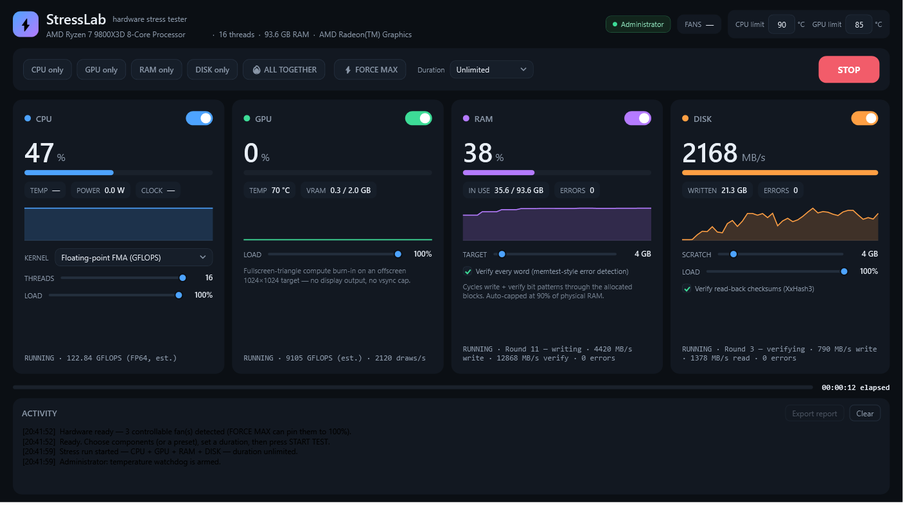

# ⚡ StressLab — Hardware Stress Tester

**One beautiful dark window. Three engines. Burn in your CPU, GPU and RAM — alone or all together — with live temperatures, a thermal watchdog and a memory-integrity verifier.**




---

## Why StressLab

Most stress tools are either ancient (Prime95), single-component (FurMark, MemTest86), or
a terminal soup. StressLab is one modern WPF app that does all three components **together
or individually**, shows you what is happening in real time, and protects your hardware
while doing it:

- **Live truth, not guesses** — real sensor polling (temperatures, power, clocks, VRAM)
  via LibreHardwareMonitor, drawn into per-component sparklines and gauges 4×/second.
- **A real memory integrity test** — not an allocation hog: StressLab cycles deterministic
  bit patterns through the memory and **verifies every 64-bit word read-back**, memtest-style.
  Any mismatch is counted with its address. `0 errors` after a run is a meaningful result.
- **An honest GPU burn-in** — a 512-iteration ALU-heavy pixel shader rendered to an
  offscreen 1024×1024 target, with **slow-start queue fencing**: the submission rate
  self-paces to the GPU's true execution rate, so counters measure *executed* work and
  even fragile drivers stay far away from the TDR window.
- **A thermal watchdog** — set CPU/GPU °C limits (defaults 90/85). The instant a sensor
  crosses the line, every engine stops and a red banner tells you what happened.
- **A UI that never freezes** — the interface thread always outranks the stress workers,
  STOP only flips a flag (cleanup happens on background threads), and every engine is
  wrapped so errors surface as messages, never crashes.

## Features

| Component | What it does | What you see |
|---|---|---|
| **CPU** | Up to all logical cores × 3 kernels: SIMD floating-point FMA (Vector256/512 — pushes more heat than scalar code), integer mix (branch-heavy), prime sieve (cache + branch) | load %, °C, watts, GHz, GFLOPS/M-ops per second |
| **GPU** | Fullscreen-triangle D3D11 pixel-shader burn-in, offscreen target, no vsync, no display output, device-removal (TDR) detection | load %, °C, VRAM, draws/s + estimated GFLOPS |
| **RAM** | Memtest-style pattern write + verify across up to 90% of physical RAM (auto-capped, auto-reserved), 5 rotating patterns | in-use %, MB/s read/write, error count |
| **DISK** | Rewrites a bounded scratch file (1–32 GB) in shuffled block order at full speed, then verifies every 1 MiB block's XxHash3 checksum on read-back. Scratch file is deleted automatically. Some SSD wear per run is normal. | MB/s write/read, total written, checksum error count |
| **ALL** | Every enabled engine runs simultaneously — the real "gaming + compiling + downloading" worst case | everything at once |

### ⚡ FORCE MAX

One toggle that forces the whole machine toward maximum:

- **Fans pinned to 100%** — every controllable PWM fan StressLab can see through the
  hardware driver (run as administrator). The FANS chip in the header shows live RPM.
- **Aggressive-boost power plan** — duplicates your current Windows power scheme, sets
  min/max processor state to 100% with Aggressive boost mode, and activates it.
- **No sleep** — the system cannot idle to sleep mid-test.

Everything is restored automatically when you toggle it off or close the app (fans back
to their BIOS curves, original power plan re-activated, duplicate plan deleted). If a
board exposes no PWM controls, FORCE MAX still boosts the power plan — StressLab tells
you exactly what it found.

Extras: presets (CPU only / GPU only / RAM only / 🔥 ALL TOGETHER), run durations from 30 s
to unlimited, live activity log, a branded taskbar/title-bar icon, and **automatic
post-run reports** (see below).

## Reports — know about the smallest problem

The moment a run finishes, StressLab writes two files into a `reports\` folder next to the
exe (no clicking needed):

1. **`StressLab-Report-<timestamp>.md`** — the full report:
   - a **verdict badge** up top: ✅ ALL CLEAR · ⚠️ PASSED WITH WARNINGS · ❌ PROBLEMS FOUND
   - system + exact configuration tables
   - **automated findings** — every detector that fired, with evidence:
     thermal-margin breaches, sustained throughput decline (throttling), throughput
     instability, missing temperature sensors, RAM verification errors, GPU driver resets
   - per-engine deep-dive tables: min · avg · median · p95 · max for every metric
   - the complete event timeline (start, thermal approaches, errors, stops)
   - a sample-by-sample telemetry table (downsampled for readability)
2. **`StressLab-Telemetry-<timestamp>.csv`** — every 1 Hz sample of every metric at full
   resolution, for spreadsheets or scripts.

The **Export report** button re-saves the same detailed report anywhere you choose.

## Requirements

- Windows 10/11 (x64)
- A Direct3D 11-capable GPU (any GPU from the last 12+ years)
- ~70 MB disk for the portable exe

**Run as administrator** for the full experience: CPU temperature/power sensors and the
CPU thermal watchdog need LibreHardwareMonitor's kernel driver, which loads only when
elevated. Without admin everything still runs — you just lose (some) temperature sensors.

## Install (no build needed)

1. Grab `StressLab-win-x64.zip` from the
   [**latest release**](https://github.com/Michaelunkai/hardware-stress-tester/releases/latest).
2. Unzip anywhere — it is one portable `StressLab.exe`.
3. Right-click → *Run as administrator* (recommended) and press **START TEST**.

> The exe is self-contained — no .NET install, no runtime, no dependencies.

## Usage

1. **Pick components** — the toggle on each card, or a preset chip up top.
2. **Tune each engine** (optional):
   - CPU: kernel, thread count (1 → all logical cores), load % (a real duty-cycle governor).
   - GPU: load %.
   - RAM: target GB (auto-capped at 90 % of physical RAM with a 1.5 GB system reserve)
     and verify on/off.
3. **Set a duration** — 30 s … 30 min, or *Unlimited*.
4. **START TEST** — watch the gauges. Press **STOP** at any moment; it is instant.
5. **Export report** — a Markdown file with everything the run measured.

Interpreting results:

- **CPU** — GFLOPS (or M-ops/s) should hold steady for the whole run; temperatures should
  plateau below your limit. A dropping score over minutes points at thermal throttling.
- **GPU** — draws/s and estimated GFLOPS should be rock-steady. If your driver resets,
  StressLab detects it (device-removal/TDR), stops safely and tells you — lower the load
  slider or update your GPU driver.
- **RAM** — the only number that matters is **ERRORS: 0**. Anything else is bad RAM (or
  overclocking that doesn't hold — try XMP/EXPO off).

## How the guarantees work

- **Never freezes** — the UI thread runs at `Highest` priority; `STOP` flips atomic flags
  and all joins/memory-frees/GC happen on background threads; sensor reads are individually
  guarded. Worst case under full load you still get instant STOP.
- **Never crashes silently** — engine workers catch everything into a visible Error state,
  `DispatcherUnhandledException`, `AppDomain.UnhandledException` and unobserved task
  exceptions are logged to `crash-log.txt` next to the exe.
- **Never cooks your hardware** — 1-second sensor polling; CPU/GPU °C limits (editable in
  the header) abort the whole run with a red banner the moment they trip.

## Headless verification

`StressLab.exe --smoke` opens the real window, exercises every engine at small scale,
captures a screenshot of a live run, writes `smoke-result.txt` and exits
`0` (pass) / `2` (hard failure) — perfect for scripted checks:

```text
PASS: System info — AMD Ryzen 7 9800X3D 8-Core Processor, 16 threads, 93.6 GB RAM
PASS: Hardware monitor — opened (admin=True, gpuTemp=39)
PASS: CPU FMA kernel — 3,599,761,408 flops · 5.11 GFLOPS
PASS: CPU integer kernel — 354,664,448 ops · 879.4 M/s
PASS: RAM write+verify — 2,592 MB exercised · 18650 MB/s · 0 errors
PASS: Fan PWM controls — 3 controllable fan(s) found (FORCE MAX can pin them to 100%)
PASS: DISK write+verify — 3,237 MB exercised · 2252 MB/s · 0 checksum errors
PASS: GPU D3D11 shader stress — 2,047 draws · 8345 GFLOPS est.
PASS: live demo run + screenshot + detailed report & telemetry CSV generated
```

## Build from source

```powershell
# .NET 10 SDK
dotnet build StressLab.slnx -c Release
dotnet test  tests/StressLab.Tests.csproj          # 29 unit tests
dotnet publish src/StressLab.csproj -c Release -r win-x64 --self-contained true `
  -p:PublishSingleFile=true -p:IncludeNativeLibrariesForSelfExtract=true `
  -p:EnableCompressionInSingleFile=true -o release
```

The engine math (sieve, patterns, governors, watchdog, GFLOPS model) is fully unit-tested;
the `--smoke` pass is the integration test.

## Architecture

```text
src/
├─ Engines/      CpuStressor (3 kernels) · GpuStressor (D3D11 + slow-start fence) ·
│                RamTester (pattern/verify) · Governor (duty-cycle) · RingBuffer
├─ Monitoring/   HardwareMonitor (LibreHardwareMonitor + fallbacks) · ThermalWatchdog ·
│                SystemProbe · MetricsSnapshot
├─ Controls/     Sparkline · GaugeBar (custom-drawn, dependency-free)
├─ Reporting/    SessionRecord + Markdown ReportBuilder
├─ Smoke/        --smoke headless verification pass
└─ Themes/       DarkTheme.xaml — the whole dark UI kit
```

- CPU/GPU/RAM engines run on their own threads with generation counters (instant,
  race-free start/stop), burst governors for the load % slider, and lock-protected stats
  snapshots (joins never inside locks — the UI can never stall on them).
- GPU estimates are labeled *est.*: draws/s is execution-fenced truth; GFLOPS multiplies
  by a conservative fixed cost per shader iteration.

## Troubleshooting

| Symptom | Fix |
|---|---|
| No CPU temperature | Run as administrator (kernel driver needs elevation). Some boards hide package sensors — the watchdog then relies on GPU temps. |
| `GPU driver reset detected` | Your driver hit TDR under load. Update the GPU driver; lower the GPU LOAD slider. StressLab stopped safely and counted everything up to the reset. |
| GPU shows 0 % | Some GPUs (notably AMD APUs) expose few load sensors — the sparkline/status still shows executed draws/s and estimated GFLOPS. |
| RAM allocation smaller than requested | Safety caps: 90 % of physical RAM, 1.5 GB system reserve, or out-of-memory during allocation. |
| App blocked on launch | Unblock the zip (right-click → Properties → Unblock) before extracting. |

## License

[MIT](LICENSE) — stress your hardware freely.
